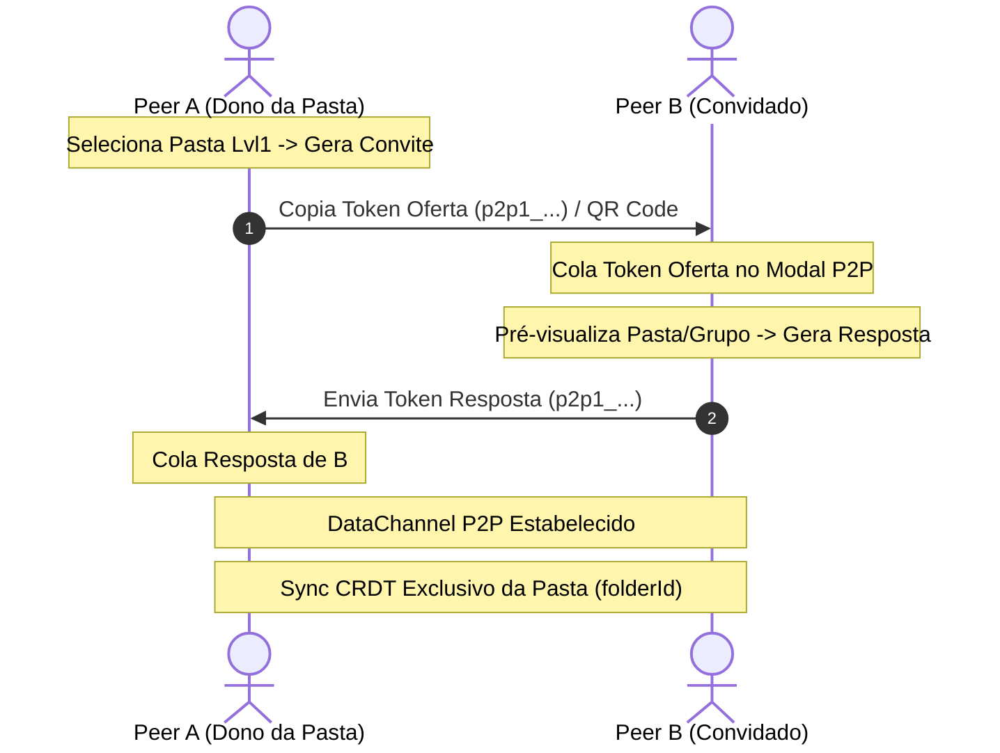

# 🤝 P2P Collaboration Engine — Documento de Referência Rápida

Documento de consulta rápida com índices e âncoras para desenvolvimento ágil, sem leitura de código fonte.

---

## 📑 Índice Rápido
1. [Visão Geral & Princípios](#1-visão-geral--princípios)
2. [Isolamento Estrito por Pasta Lvl1 (Zero-Bleed)](#2-isolamento-estrito-por-pasta-lvl1-zero-bleed)
3. [Mapa de Arquivos & Linhas-Chave](#3-mapa-de-arquivos--linhas-chave)
4. [Estrutura de Dados & Interfaces](#4-estrutura-de-dados--interfaces)
5. [Protocolo de Sinalização SDP (Serverless)](#5-protocolo-de-sinalização-sdp-serverless)
6. [Catálogo de Funções da API](#6-catálogo-de-funções-da-api)
7. [Histórico de Atualizações](#7-histórico-de-atualizações)

---

## 1. Visão Geral & Princípios
- **Tecnologia:** WebRTC DataChannels + Yjs CRDT + IndexedDB + Service Worker.
- **Topologia:** Full Mesh P2P sem servidores centrais (GitHub Pages ready).
- **Persistência:** Offline-first por pasta em IndexedDB (`svelte-jsoneditor-folder-{folderId}`).
- **Theming:** Conformidade estrita com variáveis CSS `--theme-*` (Dark, Light, Big).

---

## 2. Isolamento Estrito por Pasta Lvl1 (Zero-Bleed)
Cada pasta primária (**Level-1 / `pt.id`**) possui isolamento absoluto de dados:
- **Zero-Bleed:** Membros do Grupo B (conectados à Pasta B) **NUNCA** veem nem recebem dados da Pasta A.
- **Documento Yjs Separado:** Cada pasta cria e escuta seu próprio `Y.Doc` identificado por `folderId`.
- **Roteamento de Pacotes:** `broadcastBinaryToFolder(folderId, ...)` filtra pacotes apenas para peers com `info.folderId === targetFolderId`.
- **Sub-Tabs & Nós:** Apenas as abas e nós pertencentes a essa pasta primária (`pt.subTabIds`) entram no CRDT da pasta.

---

## 3. Mapa de Arquivos & Linhas-Chave

| Módulo | Arquivo | Responsabilidade Principal |
|---|---|---|
| **Yjs Workspace** | [`src/routes/development/p2p/yjsWorkspace.ts`](file:///c:/Users/pch/.vscode/svelte-jsoneditor/src/routes/development/p2p/yjsWorkspace.ts) | Docs Yjs por pasta, CRDT maps, sync local e flush |
| **WebRTC Manager**| [`src/routes/development/p2p/webrtcManager.ts`](file:///c:/Users/pch/.vscode/svelte-jsoneditor/src/routes/development/p2p/webrtcManager.ts) | Conexões RTCPeerConnection, DataChannels e filtro por `folderId` |
| **Tokens SDP**    | [`src/routes/development/p2p/sdpToken.ts`](file:///c:/Users/pch/.vscode/svelte-jsoneditor/src/routes/development/p2p/sdpToken.ts) | Compactação deflate/inflate, tokens `p2p1_...` e QR code SVG |
| **Mesh Gossip**   | [`src/routes/development/p2p/gossipMesh.ts`](file:///c:/Users/pch/.vscode/svelte-jsoneditor/src/routes/development/p2p/gossipMesh.ts) | Descoberta e anúncio de novos peers na malha |
| **Modal UI**      | [`src/routes/development/components/P2PCollaborationModal.svelte`](file:///c:/Users/pch/.vscode/svelte-jsoneditor/src/routes/development/components/P2PCollaborationModal.svelte) | Seletor de pasta Lvl1, abas de convite, membros e sync |
| **Workbench**     | [`src/routes/development/+page.svelte`](file:///c:/Users/pch/.vscode/svelte-jsoneditor/src/routes/development/+page.svelte) | Toolbar, indicador `👥` na aba Lvl1, gatilho de sync |
| **Tipos de Abas** | [`src/routes/development/tabUtils.ts`](file:///c:/Users/pch/.vscode/svelte-jsoneditor/src/routes/development/tabUtils.ts) | Campos `p2pGroupId` e `p2pGroupName` em `PrimaryTabState` |

---

## 4. Estrutura de Dados & Interfaces

### 4.1. Metadados de Grupo na Pasta (`PrimaryTabState`)
```typescript
interface PrimaryTabState {
  id: number;
  name: string;
  subTabIds: number[];
  p2pGroupId?: string;    // ID do grupo P2P vinculado
  p2pGroupName?: string;  // Nome amigável do grupo exibido na UI
}
```

### 4.2. Token SDP Payload (`sdpToken.ts`)
```typescript
interface SignalingPayload {
  v: 1;
  type: 'offer' | 'answer';
  sdp: string;
  from: string;
  roomId?: string;
  folderId?: number | string;  // Vinculação estrita da pasta
  folderName?: string;         // Nome para criação automática remota
  groupName?: string;
}
```

---

## 5. Protocolo de Sinalização SDP (Serverless)


---

## 6. Catálogo de Funções da API

### `yjsWorkspace.ts`
- **`getFolderDoc(folderId)`**: Retorna (ou instancia com IndexedDB) o `Y.Doc` isolado da pasta.
- **`createFolderGroup(folderId, groupName, userName)`**: Cria novo grupo P2P vinculado à pasta.
- **`syncLocalFolder(folderId, folderMeta, subTabsData)`**: Grava alterações locais no CRDT da pasta.
- **`subscribeRemoteFolderChanges(callback)`**: Notifica o workbench quando chegam dados de peers remotos.
- **`setFolderAutoSyncEnabled(folderId, enabled)`**: Pausa ou ativa o auto-sync em segundo plano.
- **`flushFolderSync(folderId)`**: Força broadcast imediato de todos os deltas acumulados.

### `webrtcManager.ts`
- **`broadcastBinaryToFolder(folderId, message)`**: Dispara binários Yjs apenas para peers daquela pasta.
- **`getPeersForFolder(folderId)`**: Lista conexões ativas na pasta selecionada.

---

## 7. Histórico de Atualizações

| Versão / Data | Descrição do Update | Arquivos Impactados |
|---|---|---|
| **v1.0 (2026-10-17)** | Implementação do isolamento estrito por pasta Level-1, seletor de pastas no modal, tokens com `folderId`, e testes de Zero-Bleed. | `yjsWorkspace.ts`, `webrtcManager.ts`, `P2PCollaborationModal.svelte`, `+page.svelte` |
| **v1.1 (2026-10-17)** | Correção crítica no escopo do modal e toolbar: remoção do fallback global que fazia todas as abas exibirem o grupo da primeira pasta, e sincronização estrita de `selectedFolderId` com a aba ativa ao abrir o modal. | `+page.svelte`, `P2PCollaborationModal.svelte` |
