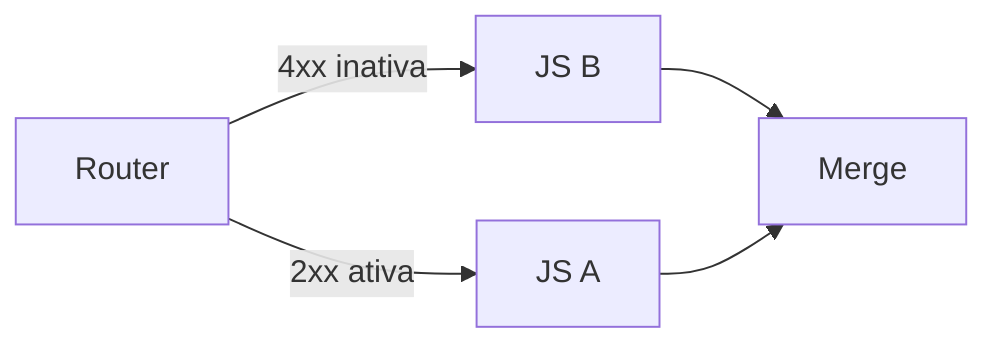

# Spatial Flow Engine — Planejamento Técnico

## Categorias ⚙️ Logic & Code e 🔀 Flow Control · Portas Dinâmicas · Branching por Portas

> Documento de planejamento. Nenhum código foi alterado ainda.
> Base: leitura de [flowTypes.ts](src/routes/development/flowTypes.ts) e [FlowCanvas.svelte](src/routes/development/components/FlowCanvas.svelte) em 13/10/2026.

---

## 0. Sumário

| #   | Seção                                                            |
| --- | ---------------------------------------------------------------- |
| 1   | Escopo e regras invioláveis                                      |
| 2   | Diagnóstico do estado atual do código                            |
| 3   | Modelo de categorias e variantes (Node Registry)                 |
| 4   | Switcher de tipo — comportamento idêntico ao Events              |
| 5   | Anatomia do card e **zona reservada** do canto superior esquerdo |
| 6   | Geometria de portas (Top / Right / Bottom / Input)               |
| 7   | Design de cada bloco                                             |
| 8   | Modelo de dados (`flowTypes.ts`)                                 |
| 9   | Execution Engine: payloads, portas e dead-path                   |
| 10  | Inspector (menu lateral) por variante                            |
| 11  | Toolbar                                                          |
| 12  | Persistência e compatibilidade                                   |
| 13  | Fases, entregáveis e critérios de aceite                         |
| 14  | Estratégia de testes                                             |
| 15  | Riscos                                                           |
| 16  | Decisões em aberto                                               |

---

## 1. Escopo e regras invioláveis

**Dentro do escopo**

| Categoria       | Bloco                        | Situação            | Entrega                                                             |
| --------------- | ---------------------------- | ------------------- | ------------------------------------------------------------------- |
| ⚙️ Logic & Code | ⚡ JS Block                  | existe              | melhorar: portas dinâmicas (até 10), `route()` / `out()`, Inspector |
| ⚙️ Logic & Code | 🔄 Transform / JSON Mapper   | novo                | completo                                                            |
| 🔀 Flow Control | 🔀 Router                    | novo                | completo                                                            |
| 🔀 Flow Control | 🔁 Loop / Iterator           | novo                | estrutura base (Future)                                             |
| 🔀 Flow Control | ⏳ Delay / Throttle          | novo                | estrutura base (Future)                                             |
| 🔀 Flow Control | 🔗 Merge / Join              | novo                | estrutura base (Future)                                             |
| Engine          | `FlowConnection` + branching | existe parcialmente | `fromPort`/`toPort` + execução só nos ramos ativos                  |

**Regras invioláveis**

1. **🌐 API & Network (REST)** e **⭕ Events (Start, Terminate, Event Throw, Event Catch)** não mudam: nem markup, nem CSS, nem comportamento.
2. O **canto superior esquerdo** de todo card retangular é **zona reservada** para o botão de troca de tipo. Nenhuma porta, ícone ou ação pode ocupar essa área (seção 5).
3. O switcher das novas categorias deve se **comportar exatamente** como o switcher do Events (seção 4).
4. O canvas fica limpo e diagramático. Configuração pesada fica no Inspector.
5. Fluxos salvos hoje continuam abrindo e executando igual (seção 12).

---

## 2. Diagnóstico do estado atual do código

Uma sessão anterior começou Router e portas no `FlowCanvas.svelte` mas **não completou o `flowTypes.ts`**. Resultado: o projeto hoje **não passa no type-check**.

| Problema                                     | Onde                                 | Impacto                                                                                                            |
| -------------------------------------------- | ------------------------------------ | ------------------------------------------------------------------------------------------------------------------ |
| `svelte-check`: **123 erros**                | `FlowCanvas.svelte`                  | `routerData`, `FlowNodePort`, `PortSlot`, `FlowNodeRouterRule`, `FlowNodeRouterData` não existem em `flowTypes.ts` |
| Funções importadas que não existem           | `FlowCanvas.svelte` L14-24           | `createDefaultRouterPorts`, `createDefaultRouterRules`, `evaluateRouterRules`, `matchStatusPattern`                |
| `FlowNodeType` sem `'router'`                | `flowTypes.ts` L4                    | comparações `type === 'router'` acusam "no overlap"                                                                |
| `FlowConnection` sem `fromPort`              | `flowTypes.ts` L94                   | o canvas já grava `fromPort`, mas o tipo não conhece                                                               |
| `executeJsSandbox` não retorna `activePorts` | `flowTypes.ts` L112                  | o engine lê `res.activePorts` que nunca existe; `route()`/`out()` não estão implementados                          |
| `parseFlowFile` descarta `fromPort`          | `flowTypes.ts` L533-538              | ao abrir um arquivo salvo, todas as conexões de portas perdem a porta                                              |
| `VALID_FLOW_NODE_TYPES` sem novos tipos      | `flowTypes.ts` L485                  | abrir um fluxo com Router gera "Invalid node in flow file"                                                         |
| Erro de sintaxe no teste                     | `FlowCanvas.test.ts` L611            | `})` extra; a suíte não compila                                                                                    |
| Portas multi ficam todas na direita          | `FlowCanvas.svelte` L2754, CSS L5807 | não atende o layout Top / Right / Bottom                                                                           |
| Bézier só horizontal                         | `getBezierPath` L2093                | fio que sai do topo/base sai "de lado"                                                                             |
| Bloqueio no dead-path                        | `isReadyToRun` L1516                 | nó com entrada _solid_ vinda de um nó **pulado** espera para sempre (ver 9.4)                                      |

**Conclusão:** a primeira fase é **estabilizar** (fazer compilar e testar) antes de qualquer feature nova.

---

## 3. Modelo de categorias e variantes (Node Registry)

### 3.1 Conceito

Igual ao Events: **uma categoria = uma família**. Você adiciona um bloco da família e escolhe/troca a variante pelo switcher.

| Categoria        | Formato | Variantes                           | Variante padrão ao criar   |
| ---------------- | ------- | ----------------------------------- | -------------------------- |
| 🌐 API & Network | card    | REST                                | — (não tem switcher)       |
| ⭕ Events        | círculo | Start · Terminate · Jump · Receiver | Jump (comportamento atual) |
| ⚙️ Logic & Code  | card    | JS · Mapper                         | JS                         |
| 🔀 Flow Control  | card    | Router · Loop · Delay · Merge       | Router                     |

### 3.2 Registry como fonte única da verdade

Hoje "qual tipo é qual" está espalhado em `if/else` (título padrão, ícone, aba do Inspector, validação, layout). Proposta: novo arquivo `src/routes/development/flowNodeRegistry.ts`.

```ts
export type FlowCategory = 'network' | 'events' | 'logic' | 'control'

export interface FlowNodeVariantDef {
  type: FlowNodeType
  category: FlowCategory
  label: string // "JS Script"
  icon: string // "⚡"
  accent: string // "#a855f7"
  defaultTitle: string // "New JS Script"
  status: 'stable' | 'future'
  height: number // altura fixa do card (px) — necessária para portas Bottom
  inspectorTabs: SidePanelTab[]
  createData(): Partial<FlowNode> // jsData / transformData / routerData ...
  getOutputPorts(node: FlowNode): FlowNodePort[] // portas fixas ou dinâmicas
  getInputPorts(node: FlowNode): FlowNodePort[] // 1 padrão; Merge = várias
}

export const FLOW_NODE_REGISTRY: Record<FlowNodeType, FlowNodeVariantDef>
export function variantsOf(category: FlowCategory): FlowNodeVariantDef[]
export function categoryOf(type: FlowNodeType): FlowCategory
```

Quem passa a consumir o registry: toolbar, switcher, `addNodeAt`, Inspector (abas), `autoLayout` (altura), geometria de portas, `VALID_FLOW_NODE_TYPES`.

> Os blocos REST e Events entram no registry **apenas como dados descritivos**. O markup e CSS deles continuam os mesmos.

---

## 4. Switcher de tipo — comportamento idêntico ao Events

### 4.1 Como o Events funciona hoje (referência exata)

| Aspecto                   | Implementação atual                                                                            |
| ------------------------- | ---------------------------------------------------------------------------------------------- |
| Estado                    | `activeCircleSwitcherId: string \| null` — **só um switcher aberto por vez**                   |
| Botão                     | `.circle-switch-btn`, 18×18px, `top:-6px; left:-6px`, ícone ↻ (SVG)                            |
| Visibilidade do botão     | aparece em `:hover`, `.is-selected` e com switcher aberto                                      |
| Abrir/fechar              | clique no botão → `toggleCircleSwitcher(id)`                                                   |
| Painel                    | `.circle-type-control`: pílula flutuante **acima** do nó, seta (`::after`) apontando para o nó |
| Opções                    | botões com disco colorido + nome; o tipo atual fica `.active`                                  |
| Posicionamento adaptativo | `.align-left` quando `x < 150`; `.align-bottom` (abre embaixo) quando `y < 55`                 |
| Fecha quando              | escolhe uma opção · clica de novo no botão · clica no canvas vazio · seleciona outro nó        |
| Ao criar pela toolbar     | o switcher **já abre** (`activeCircleSwitcherId = newNode.id`)                                 |
| Ao trocar                 | mesmo `id`, mesma posição, **conexões preservadas**, título atualizado                         |

### 4.2 Especificação para Logic & Code e Flow Control

Todos os itens da tabela 4.1 valem **sem exceção**, com estas definições:

| Item                | Regra                                                                                                                                          |
| ------------------- | ---------------------------------------------------------------------------------------------------------------------------------------------- |
| Estado              | **reutiliza o mesmo** `activeCircleSwitcherId` → abrir o switcher de um card fecha o de um círculo e vice-versa                                |
| Botão               | mesmo tamanho, mesmo ícone ↻, mesmo hover/selected; posição `top:-6px; left:-6px` do card (zona reservada)                                     |
| Painel              | mesma pílula, mesma seta, mesmo `align-left` / `align-bottom`                                                                                  |
| Opções Logic & Code | `⚡ JS Script` · `🔄 JSON Mapper`                                                                                                              |
| Opções Flow Control | `🔀 Router` · `🔁 Loop` · `⏳ Delay` · `🔗 Merge`                                                                                              |
| Variante Future     | aparece no switcher com tag discreta `soon`; é selecionável (cria o card base)                                                                 |
| Implementação       | novo componente `NodeTypeSwitcher.svelte` com classes próprias que **copiam** o visual do `.circle-type-control`. O CSS do Events não é tocado |

### 4.3 O que acontece com os dados ao trocar de variante

O Events não precisa disso porque seus tipos não têm configuração pesada. Cards têm. Regras:

1. **Dados não são apagados.** `jsData`, `transformData`, `routerData` etc. ficam guardados no nó. Trocar JS → Mapper → JS devolve o script intacto.
2. **Título:** só é trocado se ainda for o título padrão da variante anterior. Título digitado pelo usuário é mantido.
3. **Conexões de entrada:** sempre preservadas.
4. **Conexões de saída:**
   - porta com o mesmo `id` existe na nova variante → preservada;
   - porta não existe → conexão removida, com toast: _"2 conexões removidas (portas inexistentes em JSON Mapper)"_.
5. `status`, `lastRun` e `history` são zerados (o resultado anterior não vale para o novo tipo).

---

## 5. Anatomia do card e zona reservada

### 5.1 Medidas atuais (CSS)

| Elemento                 | Valor                                                   |
| ------------------------ | ------------------------------------------------------- |
| Largura                  | 280px                                                   |
| Header                   | `padding: 7px 10px` → ~36px de altura                   |
| Porta de entrada         | `left:-8px; top:40px`, 14×14 → centro em **y = 47**     |
| Botão switcher (círculo) | 18×18 em `top:-6; left:-6` → ocupa x∈[-6,12], y∈[-6,12] |

### 5.2 Zona reservada (canto superior esquerdo)

```
   x=-10                x=120
y=-10 ┌──────────────────┐
      │  ZONA RESERVADA  │   proibido: portas, tooltips de porta,
      │   (↻) switcher   │   badges, ícones de ação
y=36  └──────────────────┘   (= fim do header)
```

| Regra                                | Valor                                                          |
| ------------------------------------ | -------------------------------------------------------------- |
| Área reservada                       | x ∈ [-10, 120], y ∈ [-10, 36]                                  |
| Portas **Top**                       | só a partir de x ≥ 150 (metade direita)                        |
| Porta de **entrada** (lado esquerdo) | y ≥ 40 (abaixo do header) — já é assim hoje                    |
| Entradas do **Merge**                | distribuídas em y ∈ [48, H-24]; nunca acima de 40              |
| Ícone do tipo no header              | mantém `padding-left` ≥ 20px para não ficar embaixo do botão ↻ |

### 5.3 Anatomia final do card

```
          ZONA RESERVADA            PORTAS TOP (x ≥ 150)
          ┌──────────┐                (T1)     (T2)     (T3)
         (↻)─────────┴───────────────●────────●────────●───┐
         │ [⚡] Título editável                    [▶] [×] │
   (IN) ●├─────────────────────────────────────────────────┤● (R1)
         │                                                 │● (R2)
         │  corpo: resumo visual curto                     │● (R3)
         │                                                 │● (R4)
         ├─────────────────────────────────────────────────┤
         │  status · duração · resumo           [↗ Editor] │
         └──────────────────────────────●────────●────────●┘
                                      (B1)     (B2)     (B3)
                                     PORTAS BOTTOM (x ≥ 150)
```

---

## 6. Geometria de portas (Top, Right, Bottom)

### 6.1 Diagrama Físico do Card e Portas (Baseado no Esboço do Usuário)

O posicionamento das portas segue rigorosamente a distribuição física especificada pelo usuário (esboço anexado), onde portas de saída ficam no **Top** (topo), **Right** (lateral direita) e **Bottom** (base inferior), e a entrada fica na lateral esquerda:

```
                      (9)      (5)      (2)     <-- SLOT TOP (x ≥ 150)
                       ●        ●        ●
        ┌──────────────┴────────┴────────┴─────────┐
        │                                          │● (7)
        │                                          │● (1)  <-- SLOT RIGHT (Middle)
 (IN)  ●│             CORPO DO BLOCO               │● (4)
        │                                          │● (8)
        │                                          │
        └──────────────┬────────┬────────┬─────────┘
                       ●        ●        ●     <-- SLOT BOTTOM (x ≥ 150)
                      (10)     (6)      (3)
```

### 6.2 Sequência de Adição de Portas (1 até 10)

Conforme a convenção desenhada pelo usuário, a numeração/ordem das 10 portas possíveis é distribuída alternando entre as bordas de forma equilibrada:

| Porta # | Borda Física | Slot no Modelo |                  Posição Relativa                   | Semântica Típica              |
| :-----: | :----------: | :------------: | :-------------------------------------------------: | :---------------------------- |
|  **1**  |   Direita    |    `middle`    |             Centro vertical (`y ≈ 50%`)             | Saída principal / Default     |
|  **2**  |     Topo     |     `top`      |              Topo-direito (`x ≈ 230`)               | Sucesso / 2xx / Caminho Feliz |
|  **3**  |     Base     |    `bottom`    |              Base-direita (`x ≈ 230`)               | Erro / 4xx/5xx / Fallback     |
|  **4**  |   Direita    |    `middle`    |              Centro-baixo (`y ≈ 65%`)               | Regra Secundária              |
|  **5**  |     Topo     |     `top`      |               Topo-centro (`x ≈ 190`)               | Rota Alternativa Superior     |
|  **6**  |     Base     |    `bottom`    |               Base-centro (`x ≈ 190`)               | Rota de Exceção               |
|  **7**  |   Direita    |    `middle`    |              Direita-cima (`y ≈ 35%`)               | Regra de Negócio 1            |
|  **8**  |   Direita    |    `middle`    |              Direita-baixo (`y ≈ 80%`)              | Regra de Negócio 2            |
|  **9**  |     Topo     |     `top`      | Topo-esquerda (`x ≈ 150`, limite da zona reservada) | Sucesso Especial / Bypass     |
| **10**  |     Base     |    `bottom`    |              Base-esquerda (`x ≈ 150`)              | Descarte / Dead-letter        |

### 6.3 Slots e Limites Físicos

| Slot             | Borda    |     Máx. Portas      | Cor Padrão           | Vetor do Fio (Bézier)                |
| ---------------- | -------- | :------------------: | -------------------- | ------------------------------------ |
| `top`            | Superior |          3           | `#10b981` (verde)    | Sai para **CIMA** `(x, y - k)`       |
| `middle`         | Direita  |          4           | `#f59e0b` (âmbar)    | Sai para a **DIREITA** `(x + k, y)`  |
| `bottom`         | Inferior |          3           | `#ef4444` (vermelho) | Sai para **BAIXO** `(x, y + k)`      |
| **Total Saídas** |          |        **10**        |                      |                                      |
| `input`          | Esquerda | 1 (ou 2..5 no Merge) | `#3883fa` (azul)     | Entra pela **ESQUERDA** `(x - k, y)` |

### 6.4 Fórmulas Exatas e Tabela de Coordenadas Fixas (W = 280px, H = 140px)

Conforme o esboço original (`media_1791882218707.png`), as 10 portas possuem posições físicas e fixas nas bordas do card (altura padronizada de 140px):

```ts
export const FIXED_PORT_SLOTS: Record<
  number,
  { slot: PortSlot; relX: number; relY: number; direction: Direction }
> = {
  1: { slot: 'middle', relX: 280, relY: 72, direction: 'right' }, // Direita (centro)
  2: { slot: 'top', relX: 225, relY: 0, direction: 'top' }, // Topo (direita, espaço livre dos botões ▶ e ×)
  3: { slot: 'bottom', relX: 225, relY: 140, direction: 'bottom' }, // Base (direita, 55px livre do canto e da porta 8)
  4: { slot: 'middle', relX: 280, relY: 96, direction: 'right' }, // Direita (baixo)
  5: { slot: 'top', relX: 185, relY: 0, direction: 'top' }, // Topo (centro)
  6: { slot: 'bottom', relX: 185, relY: 140, direction: 'bottom' }, // Base (centro, colado na borda inferior)
  7: { slot: 'middle', relX: 280, relY: 48, direction: 'right' }, // Direita (topo)
  8: { slot: 'middle', relX: 280, relY: 120, direction: 'right' }, // Direita (fundo)
  9: { slot: 'top', relX: 150, relY: 0, direction: 'top' }, // Topo (esquerda, limite da zona reservada)
  10: { slot: 'bottom', relX: 150, relY: 140, direction: 'bottom' } // Base (esquerda, colado na borda inferior)
}
```

- **Alinhamento Vertical Top/Bottom:** Slot 9 alinha perfeitamente com Slot 10 (`x = 150`), Slot 5 com Slot 6 (`x = 185`), e Slot 2 com Slot 3 (`x = 225`).
- **Alinhamento das Portas na Borda Inferior:** Como o card tem altura fixa de `140px` com `display: flex; flex-direction: column; justify-content: space-between`, as portas da base inferior em `y = 140` ficam rigorosamente montadas sobre a linha inferior do card (centro da porta exatamente na borda), nunca flutuando no ar.
- **Entrada Padrão (Left):** `x = 0, y = 70` (centro vertical exato da borda esquerda).
- **Entradas do Merge (Multi-Input):** Distribuídas na borda esquerda em `y ∈ [48, 120]`, respeitando a zona reservada (`y ≥ 48`).

Para que as portas da base inferior (`bottom`) tenham ancoragem determinística:

### 6.5 Altura Fixa e Padronizada por Variante (Cards Slim)

Seguindo o feedback do usuário, **nenhum bloco deve ter card grande ou verticalmente esticado**. O corpo do card permanece enxuto, minimalista e diagramático (1 a 2 linhas curtas, exatamente no padrão do JS Block existente):

| Variante            | Altura Base | Com Multi-Portas | Conteúdo Central                                      |
| ------------------- | :---------: | :--------------: | ----------------------------------------------------- |
| **⚡ JS Block**     |    140px    |      160px       | 1ª linha do código + chip `🔀 N portas`               |
| **🔄 JSON Mapper**  |    140px    |      160px       | 1 linha de mapeamento + chip `🔄 N campos`            |
| **🔀 Router Block** |    140px    |      160px       | 1 linha com rotas + chip `[ First Match ] · N regras` |
| **🔁 Loop Block**   |    140px    |      160px       | 1 linha com array path + chip `🔁 item / done`        |
| **⏳ Delay Block**  |    140px    |      160px       | 1 linha com tempo + chip `⏳ buffer: N`               |
| **🔗 Merge Block**  |      —      |      160px       | 1 linha de sincronização + chip `🔗 N entradas`       |

### 6.6 Curvatura Bézier Específica por Borda

A curva do fio conecta a origem ao destino respeitando o ângulo de saída de cada borda:

- Origem no **Top**: vetor de controle tangencial para cima `(x1, y1 - max(40, dy * 0.5))`.
- Origem no **Right**: vetor de controle tangencial para a direita `(x1 + max(40, dx * 0.5), y1)`.
- Origem no **Bottom**: vetor de controle tangencial para baixo `(x1, y1 + max(40, dy * 0.5))`.
- Destino no **Left** (Input): vetor de controle tangencial para a esquerda `(x2 - max(40, dx * 0.5), y2)`.

Isso garante que cabos saindo do topo façam um arco gracioso por cima do bloco, cabos saindo da base desçam suavemente, e cabos laterais mantenham o fluxo horizontal natural do Node-RED.

---

## 7. Design de cada bloco (Cards Slim & Diagramáticos)

Todos os cards retangulares possuem largura de **280px**, altura compacta de **140px a 160px**, `border-left: 3px solid <accent>`, header com ícone + título editável + botões `[▶]` e `[×]`, corpo minimalista de 1–2 linhas e rodapé com status da execução.

### 7.1 ⚡ JS Block — Logic & Code (Referência de Design)

| Item           | Definição                                                             |
| -------------- | --------------------------------------------------------------------- |
| Accent         | `#a855f7` (roxo)                                                      |
| Altura         | 140px (sem portas) ou 160px (com portas)                              |
| Entrada        | 1 (esquerda, `y = 47`)                                                |
| Saídas         | 1 saída padrão à direita **ou** até 10 portas em Top / Right / Bottom |
| Corpo (Centro) | 1ª linha de código (código monospace truncado) + chip `🔀 4 portas`   |
| Rodapé         | status · tempo de execução · porta ativada · link `[↗ Editor]`        |

```
         (↻)                         (ok)     (vip)
          ┌───────────────────────────●────────●───────────┐
          │ [⚡] Validar Personagem                [▶] [×] │
     (IN) ●├───────────────────────────────────────────────┤● (default)
          │  const s = pm.environment.get('status')        │
          │  🔀 4 portas configuradas                      │
          ├───────────────────────────────────────────────┤
          │  OK · 8ms · → ok                    [↗ Editor] │
          └───────────────────────────────●────────────────┘
                                       (erro)
```

---

### 7.2 🔄 JSON Mapper — Logic & Code (Slim)

| Item            | Definição                                                              |
| --------------- | ---------------------------------------------------------------------- |
| Accent          | `#06b6d4` (ciano)                                                      |
| Altura          | 160px                                                                  |
| Entrada / Saída | 1 entrada (esquerda) / 1 saída (direita)                               |
| Corpo (Centro)  | Linha curta de resumo `user ➔ billing` + chip `🔄 4 campos · ✓ válido` |
| Rodapé          | status · tempo · link `[↗ Editor]`                                     |

```
         (↻)
          ┌────────────────────────────────────────────────┐
          │ [🔄] Mapear Cliente                    [▶] [×] │
     (IN) ●├───────────────────────────────────────────────┤● (out)
          │  user ➔ billing.profile                        │
          │  🔄 4 campos mapeados · ✓ válido               │
          ├───────────────────────────────────────────────┤
          │  OK · 1ms                           [↗ Editor] │
          └────────────────────────────────────────────────┘
```

---

### 7.3 🔀 Router Block — Flow Control (Slim — Sem Textão no Centro!)

| Item           | Definição                                                                                     |
| -------------- | --------------------------------------------------------------------------------------------- |
| Accent         | `#f59e0b` (âmbar)                                                                             |
| Altura         | **160px** (enxuto, mesma altura do JS Block!)                                                 |
| Entrada        | 1 (esquerda, `y = 47`)                                                                        |
| Saídas         | até 10 portas em Top / Right / Bottom (distribuídas nas bordas físicas)                       |
| Corpo (Centro) | Resumo das rotas em 1 linha `2xx, admin, erro, otherwise` + chip `[ First Match ] · 4 regras` |
| Rodapé         | `ROUTED → 2xx` ou `NO_ROUTE` · link `[↗ Editor]`                                              |

```
         (↻)                         (2xx)
          ┌───────────────────────────●────────────────────┐
          │ [🔀] Gateway Router                    [▶] [×] │
     (IN) ●├───────────────────────────────────────────────┤● (admin)
          │  rotas: 2xx, admin, 4xx, otherwise             │
          │  [ First Match ] · 4 regras                    │
          ├───────────────────────────────────────────────┤
          │  ROUTED · 0ms · → 2xx               [↗ Editor] │
          └───────────────────────────────●────────●───────┘
                                      (cliente) (otherwise)
```

> **Atenção:** Toda a configuração densa das regras (comparações `>`, `<`, `contains`, patterns de status, etc.) fica exclusivamente no **Inspector lateral**. No Canvas, o card fica tão limpo quanto o JS Block!

---

### 7.4 🔁 Loop / Iterator — Flow Control (Slim)

| Item           | Definição                                                                |
| -------------- | ------------------------------------------------------------------------ |
| Accent         | `#6366f1` (índigo)                                                       |
| Altura         | **160px**                                                                |
| Entrada        | 1 (esquerda, `y = 47`)                                                   |
| Saídas         | `item` (Right), `done` (Bottom), `error` (Top)                           |
| Corpo (Centro) | 1 linha com array path `data.items[*]` + chip `🔁 lote: 1 · item / done` |
| Rodapé         | status · contagem de itens · link `[↗ Editor]`                           |

```
         (↻)                         (error)
          ┌───────────────────────────●────────────────────┐
          │ [🔁] Iterar Usuários                   [▶] [×] │
     (IN) ●├───────────────────────────────────────────────┤● (item)
          │  data.users[*]                                 │  (emite cada item)
          │  🔁 lote: 1 · [ item / done ]                  │
          ├───────────────────────────────────────────────┤
          │  IDLE · 0/12 items                  [↗ Editor] │
          └───────────────────────────────●────────────────┘
                                       (done)
                                 (ao finalizar)
```

---

### 7.5 ⏳ Delay / Throttle — Flow Control (Slim)

| Item           | Definição                                                         |
| -------------- | ----------------------------------------------------------------- |
| Accent         | `#10b981` (verde)                                                 |
| Altura         | **160px**                                                         |
| Entrada        | 1 (esquerda, `y = 47`)                                            |
| Saídas         | `out` (Right), `dropped` (Bottom), `bypass` (Top)                 |
| Corpo (Centro) | 1 linha com duração `pause: 1500 ms` + chip `⏳ buffer fila: 100` |
| Rodapé         | status · tempo restante · link `[↗ Editor]`                       |

```
         (↻)                         (bypass)
          ┌───────────────────────────●────────────────────┐
          │ [⏳] Rate Limiter                      [▶] [×] │
     (IN) ●├───────────────────────────────────────────────┤● (out)
          │  pause: 1500 ms                                │  (após delay)
          │  ⏳ fila: 0/100 · taxa: 10 req/s               │
          ├───────────────────────────────────────────────┤
          │  IDLE · ready                       [↗ Editor] │
          └───────────────────────────────●────────────────┘
                                      (dropped)
```

---

### 7.6 🔗 Merge / Join — Flow Control (Slim · Multi-Input)

| Item           | Definição                                                                              |
| -------------- | -------------------------------------------------------------------------------------- |
| Accent         | `#8b5cf6` (violeta)                                                                    |
| Altura         | **160px**                                                                              |
| Entradas       | 2 a 5 entradas na esquerda (`in_1`, `in_2`...), **iniciadas estritamente em y ≥ 48px** |
| Saídas         | `joined` (Right), `timeout` (Bottom), `partial` (Top)                                  |
| Corpo (Centro) | 1 linha de estratégia `wait-all (3 branches)` + chip `🔗 unificar objetos`             |
| Rodapé         | status · sincronização (ex: `2/3 prontos`) · link `[↗ Editor]`                         |

```
         (↻)                         (partial)
          ┌───────────────────────────●────────────────────┐
          │ [🔗] Sincronizar Ramos                 [▶] [×] │
  (IN 1) ●├───────────────────────────────────────────────┤● (joined)
          │  wait-all (3 branches)                         │  (unificado)
  (IN 2) ●│  🔗 unificar objetos · timeout: 5s             │
          │                                                │
  (IN 3) ●├───────────────────────────────────────────────┤
          │  WAITING · 2/3 branches             [↗ Editor] │
          └───────────────────────────────●────────────────┘
                                      (timeout)
```

---

### 7.7 Tabela Comparativa de Todos os Blocos

| Bloco                | Categoria        | Ícone |  Accent   |  Altura   | Entradas | Saídas | Centro do Card (Slim)               |
| -------------------- | ---------------- | :---: | :-------: | :-------: | :------: | :----: | ----------------------------------- |
| **REST Block**       | 🌐 API & Network |  🌐   | `#3883fa` |  ~140px   |    1     |   1    | Método HTTP + URL + captures        |
| **Events**           | ⭕ Events        |  ⭕   |  Radial   |   50px    |   0–1    |  0–1   | Círculo BPMN com símbolo            |
| **JS Block**         | ⚙️ Logic & Code  |  ⚡   | `#a855f7` | 140–160px |    1     | 1 a 10 | 1ª linha do código + chip de portas |
| **JSON Mapper**      | ⚙️ Logic & Code  |  🔄   | `#06b6d4` |   160px   |    1     |   1    | Resumo do schema + chip de campos   |
| **Router Block**     | 🔀 Flow Control  |  🔀   | `#f59e0b` | **160px** |    1     | até 10 | 1 linha com rotas + chip de regras  |
| **Loop / Iterator**  | 🔀 Flow Control  |  🔁   | `#6366f1` |   160px   |    1     | 2 a 3  | Array path + chip item/done         |
| **Delay / Throttle** | 🔀 Flow Control  |  ⏳   | `#10b981` |   160px   |    1     | 1 a 3  | Duração / taxa + chip de fila       |
| **Merge / Join**     | 🔀 Flow Control  |  🔗   | `#8b5cf6` |   160px   |  2 a 5   | 1 a 3  | Estratégia join + chip de entradas  |

---

## 8. Modelo de dados (`flowTypes.ts`)

```ts
export type FlowNodeType =
  | 'rest'
  | 'start'
  | 'terminate'
  | 'event-throw'
  | 'event-catch' // existentes
  | 'js'
  | 'transform' // Logic & Code
  | 'router'
  | 'loop'
  | 'delay'
  | 'merge' // Flow Control

export type PortSlot = 'top' | 'middle' | 'bottom'

export interface FlowNodePort {
  id: string // estável; usado em route()/out() e em FlowConnection.fromPort
  label: string
  slot: PortSlot
  color?: string
}

// ---------- Logic & Code ----------
export interface FlowNodeJsData {
  code: string
  ports?: FlowNodePort[] // ausente/vazio = saída única (compatível)
}

export type MapperModifier =
  | 'direct'
  | 'uppercase'
  | 'lowercase'
  | 'trim'
  | 'number'
  | 'string'
  | 'boolean'

export interface FlowNodeTransformMapping {
  id: string
  sourcePath: string // "user.address.city"
  targetPath: string // "billing.city"
  modifier: MapperModifier
  defaultValue?: string // usado se a origem for undefined/null
}

export interface FlowNodeTransformData {
  sampleInput: string // JSON de exemplo (preenchido da última execução ou colado)
  mappings: FlowNodeTransformMapping[]
  saveToEnvVar?: string // opcional: também grava o resultado numa variável
}

// ---------- Flow Control ----------
export type RouterRuleType = 'status' | 'jsonpath' | 'otherwise'
export type RouterOperator =
  | '=='
  | '!='
  | '>'
  | '<'
  | '>='
  | '<='
  | 'contains'
  | 'exists'
  | 'not-exists'

export interface FlowNodeRouterRule {
  id: string
  portId: string
  label: string
  type: RouterRuleType
  statusPattern?: string // "200" | "200-299" | "2xx" | "200,201"
  path?: string
  operator?: RouterOperator
  value?: string
}

export interface FlowNodeRouterData {
  mode: 'first-match' | 'all-matches'
  ports: FlowNodePort[]
  rules: FlowNodeRouterRule[] // ordem importa em first-match
}

export interface FlowNodeLoopData {
  arrayPath: string
  itemVar: string
  maxIterations: number
}
export interface FlowNodeDelayData {
  mode: 'delay' | 'throttle'
  delayMs: number
  ratePerSecond?: number
}
export interface FlowNodeMergeData {
  strategy: 'wait-all' | 'first-completed' | 'combine'
  inputs: FlowNodePort[]
}

export interface FlowNode {
  /* campos existentes … */
  transformData?: FlowNodeTransformData
  routerData?: FlowNodeRouterData
  loopData?: FlowNodeLoopData
  delayData?: FlowNodeDelayData
  mergeData?: FlowNodeMergeData
}

export interface FlowConnection {
  id: string
  fromId: string
  toId: string
  fromPort?: string // ausente = saída padrão
  toPort?: string // ausente = entrada padrão
  kind: ConnectionKind
}
```

**Funções puras novas (todas testáveis, sem DOM):**

| Arquivo               | Função                                                                                                                            |
| --------------------- | --------------------------------------------------------------------------------------------------------------------------------- |
| `flowTypes.ts`        | `executeJsSandbox(code, env, globals, { payload, ports })` → retorna também `activePorts` e `portPayloads`                        |
| `flowRouter.ts`       | `matchStatusPattern`, `evaluateRouterRules(rules, mode, payload, status)`, `createDefaultRouterPorts`, `createDefaultRouterRules` |
| `flowMapper.ts`       | `flattenJsonPaths(sample)`, `applyMappings(input, mappings)`, `validateMappings(sample, mappings)`                                |
| `flowGeometry.ts`     | `getOutputPortPoint`, `getInputPortPoint`, `getBezierPath(p1, dir1, p2, dir2)`                                                    |
| `flowEngine.ts`       | `isConnActive`, `isReadyToRun`, `resolveInputPayload` (extraídos do componente)                                                   |
| `flowNodeRegistry.ts` | registry (seção 3.2)                                                                                                              |

---

## 9. Execution Engine

### 9.1 Payload entre blocos (equivalente ao `msg.payload` do Node-RED)

Hoje os blocos só conversam por variáveis de ambiente e pelo `lastRun.responseText` do nó anterior. Para portas e Mapper funcionarem, o engine passa a manter:

```ts
nodeOutputs: Map<nodeId, Map<portKey, { payload: unknown; status?: number }>>
// portKey = id da porta, ou 'out' para a saída padrão
```

| Bloco            | Payload de saída                                                                       |
| ---------------- | -------------------------------------------------------------------------------------- |
| REST             | JSON da resposta (ou texto), `status` = HTTP status                                    |
| JS sem portas    | payload de entrada (inalterado), porta `out`                                           |
| JS com portas    | por porta: valor de `out(port, data)`; com `route(port)` sem dado → payload de entrada |
| Mapper           | `applyMappings(entrada)`                                                               |
| Router           | payload de entrada repassado para cada porta casada                                    |
| Start / Receiver | `null`                                                                                 |

**Payload de entrada** de um nó = payload da porta de origem da conexão ativa que o alcançou. Com várias entradas ativas: a da última conexão concluída (Merge terá estratégia própria).

### 9.2 Sandbox JS: `route()` e `out()`

```js
// disponíveis no script, além de pm / env / globals / console
payload // somente leitura: payload de entrada
route('ok') // ativa a porta 'ok'
route(0) // ativa a 1ª porta (ordem: top → middle → bottom)
out('vip', { id: 1 }) // ativa 'vip' e define o payload dela
```

| Situação                           | Resultado                                                                          |
| ---------------------------------- | ---------------------------------------------------------------------------------- |
| Porta inexistente em `route`/`out` | erro de script: _"Porta 'xyz' não existe neste bloco"_                             |
| Bloco com portas e nenhuma ativada | sucesso + log `[WARN] Nenhuma porta ativada; ramos seguintes não serão executados` |
| Bloco sem portas                   | `route`/`out` são ignorados com aviso; saída padrão sempre ativa (compatível)      |

### 9.3 Conexão ativa

Uma conexão `c` está **ativa** quando o nó de origem terminou com sucesso **e**:

- origem sem portas → sempre;
- origem com portas → `c.fromPort ∈ activePorts(origem)`.

### 9.4 Dead-path elimination (correção necessária)

Hoje um nó cujo único caminho vem de porta inativa simplesmente nunca fica pronto. Isso funciona para o próprio nó, mas **trava** o nó seguinte se ele tiver outra entrada _solid_ esperando por ele.

Correção: novo conjunto `skippedNodes`.

```
nó X fica "skipped" quando: todas as conexões de entrada vêm de nós concluídos/skipped
                            e nenhuma delas está ativa
conexão vinda de nó skipped = inativa
```



Antes: `B` nunca roda → `C` espera `B` para sempre.
Depois: `B` vira _skipped_ → a conexão `B→C` fica inativa → `C` roda só com `A`.

Visual: nó pulado fica com opacidade 0.45 e rodapé `SKIPPED`; fio de porta inativa fica tracejado cinza durante/depois da execução.

### 9.5 Router — avaliação

1. Entrada: payload e status da conexão ativa que chegou.
2. `first-match`: regras em ordem; a primeira verdadeira ativa sua porta; `otherwise` só se nenhuma casar.
3. `all-matches`: todas as verdadeiras ativam suas portas; `otherwise` só se nenhuma casar.
4. Sem casamento e sem `otherwise` → status `error`, `NO_ROUTE` (comportamento já existente).

| Padrão de status | Exemplos aceitos    |
| ---------------- | ------------------- |
| exato            | `200`               |
| lista            | `200,201,204`       |
| faixa            | `200-299`           |
| curinga          | `2xx`, `4xx`, `5xx` |

---

## 10. Inspector (menu lateral) por variante

### 10.1 Cabeçalho comum (Logic & Code e Flow Control)

Mesma faixa de seleção do switcher do canvas, em formato de chips: `[⚡ JS] [🔄 Mapper]` ou `[🔀 Router] [🔁 Loop] [⏳ Delay] [🔗 Merge]`. Mesmas regras da seção 4.3.

### 10.2 Abas

| Variante             | Abas                                                      |
| -------------------- | --------------------------------------------------------- |
| JS                   | Script & Snippets · Ports (x/10) · Console & Output · Env |
| Mapper               | Mapping · Preview · Output                                |
| Router               | Rules · Ports (x/10) · History & Routing                  |
| Loop / Delay / Merge | Config · Output (com aviso _Future_)                      |

### 10.3 Aba Ports (JS e Router — mesmo componente)

```
┌ PORTS 6/10 ─────────────────────────────────────┐
│ ▲ TOP (2/3)                        [＋ Top]      │
│   ● ok        #10b981  id: ok           [🗑]    │
│   ● vip       #10b981  id: vip          [🗑]    │
│ ▶ RIGHT (1/4)                      [＋ Right]    │
│   ● default   #f59e0b  id: default      [🗑]    │
│ ▼ BOTTOM (1/3)                     [＋ Bottom]   │
│   ● erro      #ef4444  id: erro         [🗑]    │
└─────────────────────────────────────────────────┘
```

- Botão desabilitado quando o slot ou o total (10) estoura.
- Remover porta remove as conexões dela (com toast) e, no Router, reatribui regras órfãs para a primeira porta.
- Snippets no editor JS: `route('<id>')` e `out('<id>', payload)` gerados a partir das portas existentes.

### 10.4 Aba Rules (Router)

```
┌ ROUTING RULES (First Match) ───────────────────────────────────┐
│ Modo de Avaliação: (•) First Match (Switch)   ( ) All Matches  │
│                                                                 │
│ 1. [HTTP Status ▾]  Padrão: 200-299     ➔ Destino: [▲ 2xx ▾]  │
│    Condição: HTTP Status entre 200 e 299                        │
│                                                                 │
│ 2. [JSON Path   ▾]  Path: data.role  ==  admin  ➔ [▶ admin ▾]  │
│    Condição: Comparar propriedade do payload JSON               │
│                                                                 │
│ 3. [HTTP Status ▾]  Padrão: 4xx,5xx     ➔ Destino: [▼ erro ▾] │
│    Condição: Erro de cliente ou servidor                        │
│                                                                 │
│ 4. [Otherwise   ▾]  (Fallback Padrão)   ➔ Destino: [▼ out ▾]  │
│    Condição: Disparado se nenhuma regra anterior casar         │
│                                                                 │
│ [ ＋ Adicionar Regra ]        [ ⚡ Testar com Última Resposta ] │
└─────────────────────────────────────────────────────────────────┘
```

- Lista ordenável (↑ ↓) — ordem define a prioridade no modo `first-match`.
- Cada regra: tipo (`Status` / `JSON Path` / `Otherwise`) · campos do tipo · porta de destino (dropdown com indicador visual do slot: `▲ top`, `▶ right`, `▼ bottom`).
- **Testar com última resposta**: avalia as regras contra o payload/status do nó anterior e destaca em verde a regra casada.

### 10.5 Aba Mapping (Mapper) — Visual 2-Tree com Conexão Drag-and-Drop

```
┌ ORIGEM (Payload Entrada) ┐    ┌ DESTINO (Novo Schema) ────────┐
│ ▾ user                   │    │ customerId      ◀ user.id   ✕ │
│   id         104      ●──┼────┼▶                              │
│   name       "Rick"   ●  │    │ contact.email   ◀ user.email ✕│
│   email      "r@x"    ●──┼────┼▶                              │
│ ▾ address                │    │ billing.city    ◀ addr.city ✕ │
│   city       "Seattle"●──┼────┼▶                              │
│ └────────────────────────┘    │ ＋ novo campo                 │
│                               └───────────────────────────────┘
│
┌ PREVIEW EM TEMPO REAL ─────────────────────────────────────────┐
│ {                                                              │
│   "customerId": 104,                                           │
│   "contact": { "email": "r@x" },                               │
│   "billing": { "city": "Seattle" }                             │
│ }                                                              │
└────────────────────────────────────────────────────────────────┘
```

| Interação     | Como                                                                                                      |
| ------------- | --------------------------------------------------------------------------------------------------------- |
| Origem        | árvore gerada de `sampleInput`; botão **"Usar última resposta"** puxa do nó anterior                      |
| Ligar campos  | arrastar ● da origem até um campo do destino **ou** clicar origem → clicar destino                        |
| Criar destino | soltar uma origem em "＋ novo campo" cria o destino com o mesmo nome                                      |
| Fios          | SVG entre as colunas, recalculado com `ResizeObserver` e no scroll                                        |
| Modificador   | ícone ⚙ no destino abre opções: Direto, MAIÚSCULO, minúsculo, Trim, Número, Texto, Booleano, Valor padrão |
| Validação     | ⚠ âmbar: origem não existe no exemplo · ⛔ vermelho: destino duplicado · ⚠ número não convertível         |
| Preview       | `applyMappings(sampleInput)` a cada alteração com JSON formatado e syntax highlight                       |

### 10.6 Aba Inspector — 🔁 Loop / Iterator

```
┌ LOOP SETTINGS ─────────────────────────────────────────────────┐
│ JSON Path da Lista:                                            │
│ [ data.items[*]                                              ] │
│                                                                 │
│ Nome da Variável do Item (dentro do loop):                     │
│ [ item                                                       ] │
│                                                                 │
│ Concorrência & Lote:                                           │
│ Modo: (•) Sequencial (1 por 1)   ( ) Em Lote (Paralelo)        │
│ Tamanho do Lote: [ 5 ]                                         │
│                                                                 │
│ Limite Máximo de Iterações (Prevenção de loop infinito):       │
│ [ 1000                                                       ] │
│                                                                 │
│ Portas de Saída:                                               │
│ ▶ item  (Direita): emite `item` para cada elemento             │
│ ▼ done  (Base):    emite lista final agregada                  │
│ ▲ error (Topo):    emite payload de erro se array inválido     │
└─────────────────────────────────────────────────────────────────┘
```

### 10.7 Aba Inspector — ⏳ Delay / Throttle

```
┌ DELAY & RATE LIMIT ────────────────────────────────────────────┐
│ Modo de Operação:                                              │
│ (•) Fixed Delay (Pausa)        ( ) Rate Throttle (Controle Hz) │
│                                                                 │
│ Tempo de Pausa (ms):                                           │
│ [ 1500 ] ms                                                    │
│                                                                 │
│ Taxa Máxima (Rate Throttle):                                   │
│ [ 10 ] requisições por segundo                                 │
│                                                                 │
│ Tamanho Máximo da Fila de Espera:                              │
│ [ 100 ] itens                                                  │
│                                                                 │
│ Portas de Saída:                                               │
│ ▶ out     (Direita): payload liberado após delay               │
│ ▼ dropped (Base):    descarte quando a fila estoura            │
│ ▲ bypass  (Topo):    desvio imediato sob condição              │
└─────────────────────────────────────────────────────────────────┘
```

### 10.8 Aba Inspector — 🔗 Merge / Join (Multi-Input)

```
┌ MERGE & JOIN STRATEGY ─────────────────────────────────────────┐
│ Estratégia de Junção:                                          │
│ (•) Wait-All (Solid Join - aguarda todas as entradas ativas)   │
│ ( ) Race (Primeiro que chegar - descarta os demais)            │
│ ( ) Stream (Repassa cada chegada individualmente)              │
│                                                                 │
│ Estratégia de Combinação de Payload:                           │
│ (•) Objeto Unificado: { ...payloadA, ...payloadB }             │
│ ( ) Array Consolidado: [ payloadA, payloadB ]                  │
│ ( ) Apenas Último: sobrescreve com a última conexão            │
│                                                                 │
│ Entradas Configuradas na Borda Esquerda (y ≥ 48px):            │
│ ● Entrada 1 (in_1)  - y = 48px   [ Conectado: REST Login ]     │
│ ● Entrada 2 (in_2)  - y = 84px   [ Conectado: REST Dados ]     │
│ ● Entrada 3 (in_3)  - y = 120px  [ Vazia ]               [🗑]  │
│ [ ＋ Adicionar Porta de Entrada (máx. 5) ]                      │
│                                                                 │
│ Timeout de Junção (ms): [ 5000 ]                               │
│ Porta em Timeout: ▼ timeout (Base)                             │
└─────────────────────────────────────────────────────────────────┘
```

---

## 11. Toolbar — Agrupamento e 4 Botões de Família

A Toolbar organiza os blocos em exatamente 4 botões de família (idêntico ao modelo consagrado do Events), mantendo a barra limpa e sem proliferação de botões:

```
[▶ Run Flow] │ BLOCKS: [ 🌐 ＋ REST Block ] [ ⚡ ＋ Logic & Code ] [ 🔀 ＋ Flow Control ] [ ⭕ ＋ Event ] │ [🪄 Auto Layout] …
```

### 11.1 Mapeamento da Toolbar

| Categoria            | Botão na Barra        | Cor / Borda | Ação ao Clicar / Arrastar                                                                                                             |
| -------------------- | --------------------- | ----------- | ------------------------------------------------------------------------------------------------------------------------------------- |
| **🌐 API & Network** | `[ ＋ REST Block ]`   | `#3883fa`   | Insere o card REST Block (sem switcher)                                                                                               |
| **⚙️ Logic & Code**  | `[ ＋ Logic & Code ]` | `#a855f7`   | Insere o card JS Script (padrão). O card possui o botão `(↻)` no canto superior esquerdo para alternar para JSON Mapper               |
| **🔀 Flow Control**  | `[ ＋ Flow Control ]` | `#f59e0b`   | Insere o card Router (padrão). O card possui o botão `(↻)` no canto superior esquerdo para alternar entre Router, Loop, Delay e Merge |
| **⭕ Events**        | `[ ＋ Event ]`        | `#ec4899`   | Insere o nó circular (Jump por padrão) com o switcher `(↻)` tradicional para Start, Terminate e Receiver                              |

### 11.2 Comportamento Unificado do Switcher `(↻)`

- O botão `(↻)` fica fixo em `top: -6px; left: -6px` (dentro da **zona reservada** `x ∈ [-10, 120], y ∈ [-10, 36]`).
- Ao clicar no botão `(↻)` de qualquer card de **Logic & Code**, abre o popup suspenso para alternar entre `[ ⚡ JS Block ]` e `[ 🔄 JSON Mapper ]`.
- Ao clicar no botão `(↻)` de qualquer card de **Flow Control**, abre o popup suspenso para alternar entre `[ 🔀 Router ]`, `[ 🔁 Loop ]`, `[ ⏳ Delay ]` e `[ 🔗 Merge ]`.
- O comportamento visual, classes CSS, setas indicadoras e fechamento ao clicar fora são **100% idênticos** ao switcher já consagrado do bloco de **Events**.

---

## 12. Persistência e compatibilidade

| Caso                                   | Comportamento                                                                         |
| -------------------------------------- | ------------------------------------------------------------------------------------- |
| Fluxo antigo sem `fromPort`            | conexões usam a saída padrão; nada muda                                               |
| JS antigo sem `ports`                  | saída única, `route()`/`out()` ignorados                                              |
| `parseFlowFile`                        | passa a preservar `fromPort`/`toPort` e aceitar os novos tipos                        |
| `serializeFlowFile`                    | sem mudança de formato; `FLOW_FILE_VERSION` continua `1` (campos novos são opcionais) |
| Porta referenciada que não existe mais | conexão descartada no `parseFlowFile` com aviso no console                            |
| `remapFlowGraphIds` (import)           | já preserva campos extras via spread; adicionar teste                                 |

---

## 13. Fases, entregáveis e critérios de aceite

Cada fase termina com `npm run check` limpo e testes verdes. Nada passa para a fase seguinte quebrado.

### Fase 0 — Estabilização

- Tipos e funções faltantes em `flowTypes.ts` / `flowRouter.ts` (seção 2).
- `parseFlowFile` preserva `fromPort`/`toPort` e aceita novos tipos.
- Corrigir sintaxe de `FlowCanvas.test.ts` L611.

**Aceite:** `svelte-check` 0 erros · suíte atual passa · abrir/salvar fluxo com Router preserva portas.

### Fase 1 — Registry

- `flowNodeRegistry.ts`; `addNodeAt`, títulos padrão, ícones, `VALID_*` e alturas passam a ler dele.

**Aceite:** nenhuma mudança visual · REST e Events idênticos (comparação por screenshot).

### Fase 2 — Geometria de portas

- `flowGeometry.ts`; portas Top/Right/Bottom; zona reservada; Bézier direcional; tooltips por borda; altura fixa por variante.

**Aceite:** nenhuma porta em x∈[-10,120], y∈[-10,36] · fios saem perpendiculares à borda · portas Bottom acompanham a altura do card.

### Fase 3 — Switcher e Toolbar

- `NodeTypeSwitcher.svelte`; regras da seção 4 (incluindo 4.3); toolbar da seção 11.

**Aceite:** checklist 4.1 inteiro validado em card e círculo · só um switcher aberto por vez · trocar JS→Mapper→JS mantém o script · conexões órfãs removidas com toast.

### Fase 4 — Engine (payload + portas + dead-path)

- `nodeOutputs`; `route()`/`out()`/`payload` no sandbox; `skippedNodes`; extração para `flowEngine.ts`; visual de skipped.

**Aceite:** cenário 9.4 não trava · JS com 3 portas executa só o ramo escolhido · fluxo antigo de exemplo executa igual.

### Fase 5 — JS Block completo

- Aba Ports, snippets, corpo/rodapé do card (7.1).

### Fase 6 — Router completo

- Regras (status/lista/faixa/curinga/JSON Path/otherwise), modos, ordenação, "Testar com última resposta", card (7.3).

**Aceite:** tabela de casos da seção 14 passa.

### Fase 7 — JSON Mapper completo

- `flowMapper.ts`, aba Mapping com árvores, drag + clique, fios, modificadores, validação, preview, execução.

**Aceite:** usuário mapeia 3 campos sem digitar nenhum caminho · preview atualiza a cada ação.

### Fase 8 — Blocos base (Loop, Delay, Merge)

- Cards, Inspector _Future_, comportamento pass-through (7.4–7.6), entradas múltiplas do Merge respeitando a zona reservada.

### Fase 9 — Fechamento

- Testes de regressão, revisão visual em tema claro e escuro, atualização deste documento.

---

## 14. Estratégia de testes

| Camada     | O que testar                                                              | Arquivo                |
| ---------- | ------------------------------------------------------------------------- | ---------------------- |
| Unitário   | `matchStatusPattern`, `evaluateRouterRules` (todos os modos e operadores) | `flowRouter.test.ts`   |
| Unitário   | `applyMappings`, `validateMappings`, `flattenJsonPaths`                   | `flowMapper.test.ts`   |
| Unitário   | coordenadas por slot, zona reservada, Bézier direcional                   | `flowGeometry.test.ts` |
| Unitário   | sandbox: `route` por id/índice, `out`, porta inválida, nenhuma porta      | `flowTypes.test.ts`    |
| Unitário   | `isConnActive`, `isReadyToRun`, dead-path (cenário 9.4)                   | `flowEngine.test.ts`   |
| Unitário   | `parseFlowFile` preserva portas; troca de variante preserva dados         | `flowTypes.test.ts`    |
| Componente | switcher: abre, fecha (4 formas), troca, só um aberto                     | `FlowCanvas.test.ts`   |
| Componente | toolbar cria e abre switcher; drag & drop                                 | `FlowCanvas.test.ts`   |
| Regressão  | REST e Events: criação, execução, switcher do Events                      | `FlowCanvas.test.ts`   |

Casos mínimos do Router:

| Regras                   | Status / payload      | Modo  | Portas ativadas |
| ------------------------ | --------------------- | ----- | --------------- |
| `2xx→ok`, `otherwise→fb` | 204                   | first | ok              |
| `2xx→ok`, `otherwise→fb` | 404                   | first | fb              |
| `2xx→a`, `role==admin→b` | 200, `{role:'admin'}` | first | a               |
| `2xx→a`, `role==admin→b` | 200, `{role:'admin'}` | all   | a, b            |
| `200,201→a`              | 201                   | first | a               |
| `role exists→a`          | `{}`                  | first | — (NO_ROUTE)    |

---

## 15. Riscos

| Risco                                                | Mitigação                                                                                                                              |
| ---------------------------------------------------- | -------------------------------------------------------------------------------------------------------------------------------------- |
| `FlowCanvas.svelte` com 7.6k linhas fica ainda maior | extrair lógica pura (registry, geometria, router, mapper, engine) e componentes (`NodeTypeSwitcher`, `PortsEditor`, `MapperInspector`) |
| Alterar Events sem querer ao generalizar o switcher  | componente novo com CSS próprio; teste de regressão do switcher do Events                                                              |
| Fios do Mapper desalinhados com scroll/resize        | `ResizeObserver` + recálculo no scroll; fallback: chip `◀ origem` no destino já mostra o vínculo                                       |
| Altura fixa corta conteúdo do card                   | corpo com `overflow:hidden` e conteúdo resumido; detalhes ficam no Inspector                                                           |
| Fluxos salvos antigos quebrarem                      | campos novos opcionais; testes com o fluxo de exemplo atual                                                                            |
| `new Function` no sandbox                            | já existe hoje; fora do escopo deste plano (registrar como débito)                                                                     |

---

## 16. Decisões em aberto

Precisam de resposta antes da fase indicada.

| #   | Decisão                                                                       | Proposta deste plano                     | Fase |
| --- | ----------------------------------------------------------------------------- | ---------------------------------------- | ---- |
| 1   | Toolbar com **1 botão por categoria** (como Events) ou 1 botão por bloco      | 1 por categoria + switcher abre ao criar | 3    |
| 2   | Conexões órfãs ao trocar de variante: remover com toast ou pedir confirmação  | remover com toast                        | 3    |
| 3   | JS com portas sem nenhuma `route()`: nenhum ramo ou primeira porta por padrão | nenhum ramo + aviso                      | 4    |
| 4   | Loop: `done` na base ou as duas saídas na direita                             | `item` direita, `done` base              | 8    |
| 5   | Router sem casamento e sem otherwise: `error` (atual) ou sucesso sem rota     | manter `error`                           | 6    |
